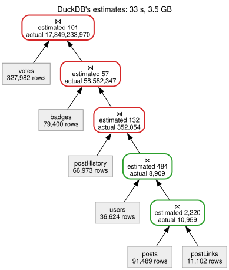
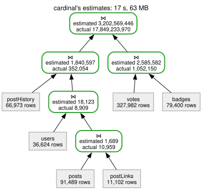

+++
date = "2026-10-30"
title = "Faster DuckDB with better cardinality estimates"
description = "cardinal is a DuckDB extension that learns Bayesian networks from your tables and feeds their row estimates to DuckDB's join-order optimizer."
tags = ['sql', 'data-eng']
toc = true
draft = true
+++

My PhD was about [cardinality estimation](/blog/phd-about/). When I wrapped it up, I wrote that "machine learning is cute, but I don't see PostgreSQL suddenly switching its cost model". Five years later, I still don't. But it turns out you don't need to switch the cost model. You just need to feed it better numbers.

I first tested the premise by [giving DuckDB perfect estimates](/blog/perfect-cardinality-estimates/). They changed almost every plan and barely changed runtime. This post is about a less accurate estimator that sometimes leads DuckDB to a faster physical plan.

DuckDB has an [extension mechanism](https://duckdb.org/docs/stable/extensions/overview), and it lets you get your hands on the optimizer. So I wrote [cardinal](https://github.com/MaxHalford/cardinal), an extension that learns a Bayesian network per table, and gives DuckDB its estimates instead of the default ones. Nothing else changes: same optimizer, same cost model, same results. Only the numbers do.

On [STATS-CEB](https://github.com/Nathaniel-Han/End-to-End-CardEst-Benchmark), a benchmark of 146 queries on a Stack Exchange dump, the whole workload goes from 130 seconds to 67 seconds. Here's why, and how.

## Join order is a guessing game

A query that joins five tables can join them in many orders. They all give the same answer, but not the same amount of work. A good order keeps intermediate results small. A bad one builds a huge intermediate table, only to whittle it down later.

DuckDB's optimizer enumerates join orders and picks the cheapest. Its notion of cost is simple: the sum of the rows each join produces. The catch is that it has to compute that cost *before* running the query. So it guesses how many rows each join produces. That's cardinality estimation, and it's [the weak link](https://www.vldb.org/pvldb/vol9/p204-leis.pdf) of most query optimizers.

## How DuckDB guesses

DuckDB's estimator is described in Tom Ebergen's [master thesis](https://blobs.duckdb.org/papers/tom-ebergen-msc-thesis-join-order-optimization-with-almost-no-statistics.pdf), whose title says it all: *join order optimization with (almost) no statistics*. In a nutshell:

- `x = 'a'` keeps the table's rows divided by the number of distinct values of `x`.
- Any other filter -- a range, a `LIKE` -- keeps 20% of the rows.
- A join produces the product of its inputs, divided by the number of distinct join keys.

This is cheap and needs almost nothing, which is great when you're querying a Parquet file you've never seen before. It's a deliberate design choice. But the join rule assumes every key has as many matching rows as every other key. For instance, that every user has the same number of badges. That's rarely the case.

## Power users break the guess

Here's query 58 of STATS-CEB:

```sql
SELECT COUNT(*)
FROM posts p, postLinks pl, postHistory ph, votes v, badges b, users u
WHERE p.Id = pl.RelatedPostId
  AND u.Id = p.OwnerUserId
  AND u.Id = b.UserId
  AND u.Id = ph.UserId
  AND u.Id = v.UserId
  AND p.CommentCount >= 0 AND p.CommentCount <= 13
  AND ph.PostHistoryTypeId = 5 AND ph.CreationDate <= '2014-08-13 09:20:10'
  AND v.CreationDate >= '2010-07-19 00:00:00'
  AND b.Date <= '2014-09-09 10:24:35'
  AND u.Views >= 0 AND u.DownVotes >= 0
  AND u.CreationDate >= '2010-08-04 16:59:53' AND u.CreationDate <= '2014-07-22 15:15:22';
```

```
17,849,233,970
```

Four tables hang off `users`: each user's posts, history edits, votes and badges. For each user, the join produces edits × votes × badges × ... rows. 36,624 users pass the filters. On average, a user has 1.6 history edits, 0.85 votes and 1.95 badges. If every user were average, joining those three tables would give 36,624 × 1.6 × 0.85 × 1.95 ≈ 97,000 rows.

The actual number is 1,389,418,172. That's 14,300 times more. Indeed, 10 users out of 36,624 account for 98% of it. User 805 alone contributes 4,052 edits × 509 votes × 314 badges = 647,614,952 rows. Power users are active everywhere: they edit a lot *and* vote a lot *and* collect badges. The skew compounds with every join.

## What DuckDB does with its guess

Here's the plan DuckDB v2.0.0 picks. It reads bottom-up. Each join shows DuckDB's estimate and the true row count, in red when the estimate is off by more than 100×:

<div align="center">
<figure style="margin: 0;">
    
</figure>
</div>

DuckDB thinks joining `badges` gives 57 rows. It gives 58 million: a million times more. So it happily joins `badges` early, and builds the last join's hash table on those 58 million rows. The query takes ~33 seconds and peaks at 3.5 GB of memory.

## A better guess, with Bayesian networks

The idea is to learn the data, rather than the queries. Cardinal fits one [Bayesian network](https://en.wikipedia.org/wiki/Bayesian_network) per table, over the columns that queries filter on. A Bayesian network answers "what fraction of rows match these filters?", while capturing the correlations between columns. I wrote [sorobn](https://github.com/MaxHalford/sorobn) and a [paper](/blog/an-approach-based-on-bayesian-networks-for-query-selectivity-estimation-slides/) about this during my PhD, so this part was familiar ground.

Joins are trickier. The trick I use comes from [BayesCard](https://arxiv.org/abs/2012.14743) by Wu et al. Each table gets extra columns, one per table that points to it. For instance, `users` gets the number of badges, votes, history edits and posts of each user. These are called *fanouts*. The Bayesian network learns them jointly with the user's own columns. So it knows power users exist, and that their counts go together.

The size of a join through `users` then boils down to an expectation: the sum, over the users that pass the filters, of badges × votes × edits × .... A Bayesian network computes this without ever building the joined table. A filter on `badges` is assumed to be independent of which user the badge belongs to. That's not always true -- moderators behave differently from the rest -- but it's a good trade-off for something this cheap.

The models are small and quick to fit. Fitting reads a sample of at most a million rows: it takes milliseconds for small tables, and around a second for large ones.

## Smuggling the numbers in

This was the fiddly part. DuckDB's optimizer doesn't let an extension answer "how many rows does this join produce?". What an extension *can* do is tell DuckDB how many rows a table scan produces, and how many distinct values a column has. DuckDB then plugs those into its own formula.

So cardinal works backwards. It estimates every join DuckDB will consider, and then solves for the row and distinct counts that make DuckDB's formula reproduce those estimates. It's a least squares problem in log space, with one unknown per table and one per join key. The fit isn't always exact -- one distinct count per join key can't express everything -- but it gets close enough.

This also means `EXPLAIN` shows the fitted numbers, which can differ from a table's actual filtered row count. That threw me off more than once.

## What DuckDB does with the better guess

Same query, same DuckDB, with cardinal loaded:

<div align="center">
<figure style="margin: 0;">
    
</figure>
</div>

The estimates aren't perfect: they're all within 6.5 times of the truth, and the last one is 5.6 times too low. But they're in the right ballpark, and that's what matters. DuckDB now sees that badges and votes explode together, so it keeps them apart. It joins them with each other (~1 million rows), joins the rest separately (352,054 rows), and only combines both at the very end. There's no 58-million-row intermediate result on the way.

The query takes ~17 seconds instead of ~33, and peaks at 63 MB of memory instead of 3.5 GB. Nothing changed in DuckDB's optimizer or cost model. Only the numbers it was given.

## Is it always better?

No. Here are five benchmarks, with DuckDB v2.0.0 alone and with cardinal:

| Benchmark | Queries | Total time | Faster / same / slower queries | Median estimate error |
|---|---|---|---|---|
| [STATS-CEB](https://github.com/Nathaniel-Han/End-to-End-CardEst-Benchmark) | 146 | 130 s → 67 s | 42 / 102 / 2 | 23× → 1.9× |
| [JOB](https://github.com/gregrahn/join-order-benchmark) | 113 | 3.5 s → 2.9 s | 29 / 74 / 10 | 19× → 2.2× |
| [JOB-light](https://github.com/andreaskipf/learnedcardinalities) | 70 | 5.0 s → 4.8 s | 7 / 61 / 2 | 5.3× → 1.5× |
| [DSB](https://github.com/microsoft/dsb), scale factor 10 | 219 | 2.5 s → 2.7 s | 0 / 196 / 23 | 4.1× → 2.2× |
| TPC-H, scale factor 10 | 22 | 1.4 s → 1.3 s | 0 / 22 / 0 | 1.3× → 1.0× |

A query counts as faster or slower when its time changes by more than 10% and 10 ms, and as the same otherwise. The estimate error is the median, over every join DuckDB considers, of how far off its estimate is from the true count.

The estimates get better everywhere. The runtime only follows where join order matters, which is when intermediate results explode: skewed many-to-many joins, like the power users above. STATS-CEB's slowest queries count billions of rows, and run twice as fast. DSB's queries take ~10 ms each at this scale, so better plans make no difference there, and small changes in the physical plan cost a few milliseconds. TPC-H's data is uniform, which DuckDB already estimates well: it's there to check cardinal does no harm.

The honest take is that DuckDB is fast whatever the join order, most of the time. Hash joins, vectorization and parallelism forgive a lot. Cardinal matters on the queries where they don't.

There are also limits. Cardinal only handles DuckDB tables, not Parquet or CSV files. Joins in a cycle, joins on several columns at once, and conditions such as `a.x < b.y` are left to DuckDB's own estimates. And because cardinal relies on DuckDB internals, each DuckDB release needs a new build.

## Trying it

Cardinal is a DuckDB [community extension](https://duckdb.org/community_extensions/extensions/cardinal), for DuckDB v2.0.0. There's nothing to configure: install it, load it, and run your queries as usual. The first query that needs a table's model fits it, and models are saved for later sessions. You can check what it learnt:

```sh
duckdb my.duckdb
```

```sql
INSTALL cardinal FROM community;
LOAD cardinal;

CREATE TABLE a AS SELECT range AS id, range % 10 AS x FROM range(1000);
CREATE TABLE b AS SELECT range % 1000 AS a_id, range % 7 AS y FROM range(10000);
SELECT count(*) FROM a, b WHERE a.id = b.a_id AND a.x = 3 AND b.y = 2;
SELECT * FROM cardinal_models();
```

```
┌─────────────┬────────────┬───────────┬──────────────────┐
│ schema_name │ table_name │ row_count │     columns      │
├─────────────┼────────────┼───────────┼──────────────────┤
│ main        │ a          │      1000 │ ['F(b.a_id)', x] │
│ main        │ b          │     10000 │ [a_id, y]        │
└─────────────┴────────────┴───────────┴──────────────────┘
```

The `F(b.a_id)` column is a fanout: how many rows of `b` point to each row of `a`.

I'd love to hear whether it helps on your queries, and especially where it makes things worse. Cardinality estimation was a research topic for me for a long time. It's nice to finally see it make a real query go faster 🦆
